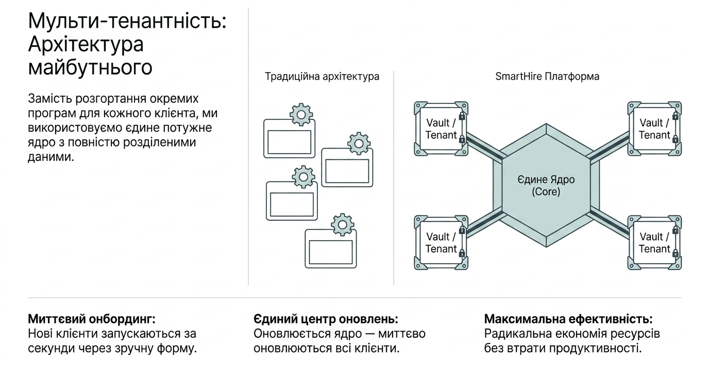
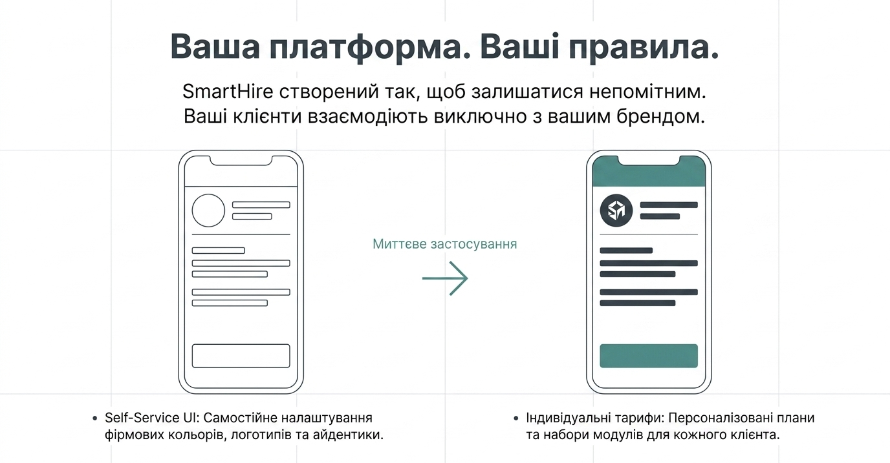
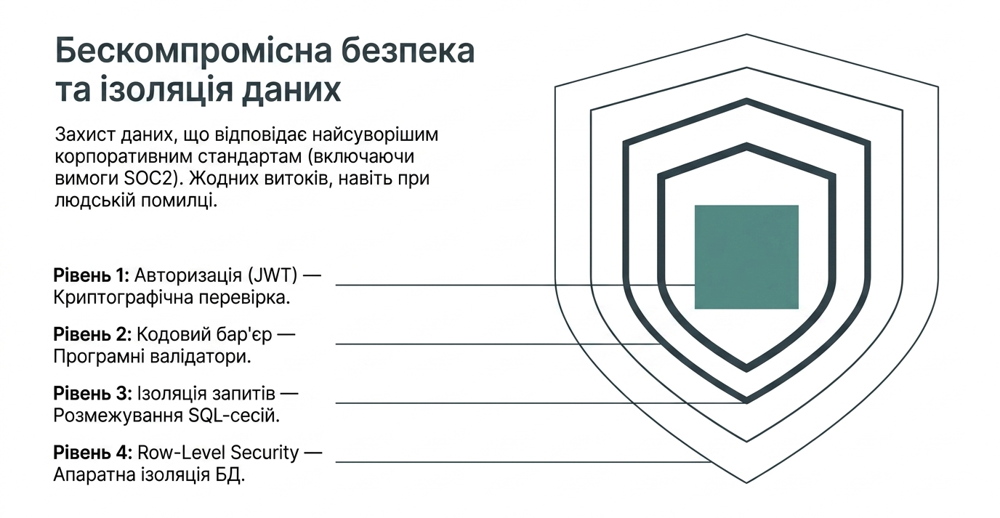
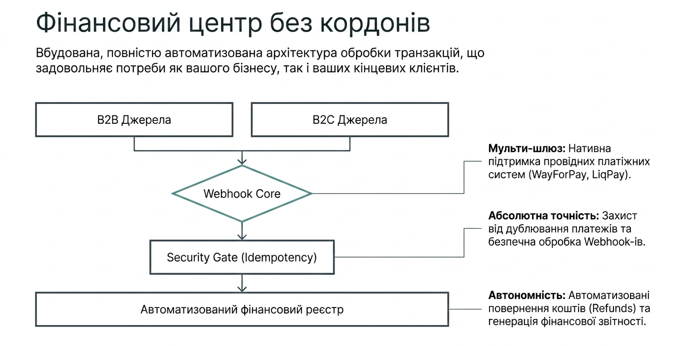

<div align="center">


# SmartHire — Architecture Showcase

### Engineering patterns from a multi-tenant B2B SaaS — designed for 1000+ tenants in a single runtime

Це публічна частина архітектури реальної SaaS-платформи: ADR, code samples,
інженерні рішення. Source code закритий з комерційних причин — те, що нижче,
дає достатньо, щоб зрозуміти, як платформа спроєктована і чому саме так.

**Статус:** pre-launch — staging-verified (deploy, migrations, RLS, payments),
перший комерційний запуск у роботі.

[](pyproject.toml)
[](https://fastapi.tiangolo.com/)
[](https://docs.aiogram.dev/)
[](#multi-tenancy-три-шари-захисту)
[](https://docs.sqlalchemy.org/)
[](dashboard/)
[](#engineering-rigor--ai-agent-guardrails)
[](docs/infrastructure.md)

[**Quick scan**](#quick-scan-30-секунд) ·
[**Inside**](#inside-the-platform) ·
[**Engineering deep-dives**](#engineering-deep-dives) ·
[**Beyond patterns**](#beyond-the-patterns-повна-карта) ·
[**Numbers**](#numbers-that-matter) ·
[**ADR**](adr/) ·
[**Контакти**](#контакти)

</div>

---

## Quick Scan (30 секунд)

| | |
|---|---|
| **Що це** | Модульна multi-tenant платформа для малого бізнесу на Telegram + Web. 7 entry points (3 боти + 4 фронтенди), FastAPI, Docker Compose |
| **Продуктові лінії** | 3 бізнес-лінії — **Shop** (вітрина/продажі), **Recruiting** (найм), **Booking** (запис) + платформені можливості (білінг, підтримка, зміни, white-label) — вмикаються per-tenant через feature flags |
| **Масштаб** | 1000+ тенантів в одному runtime, < 20% degradation під load (load-tested) |
| **Кодова база** | ~210k LOC Python prod + ~290k tests + ~69k tooling (~574k total) + ~64k TypeScript; 62 ADR, ~30 API routers, 7 pluggable-модулів у реєстрі |
| **Інженерна основа** | PostgreSQL RLS, headless service layer, basis-point money, AES-256 PII, blue-green deploys, TLA+ formal verification |
| **Бізнес-функції** | Multi-payment (WayForPay + LiqPay), White Label, self-service onboarding, billing з grace period |
| **Що відкрито тут** | ADR, sanitized code samples, архітектурні діаграми, deployment configs |
| **Що закрито** | Source code, business logic, client configs, secrets |

**Маршрути для читача:**
- 5 хвилин → [топ-патерни](#engineering-deep-dives)
- 15 хвилин → [патерни + повна карта](#beyond-the-patterns-повна-карта)
- 30 хвилин → читай по порядку, починаючи з [ADR-001](adr/001_multi_tenant_architecture.md)

---

## Inside the Platform

SmartHire — не один моноліт, а композиція з 9 функціональних доменів. Нижче — карта,
яка дає розуміння за 60 секунд, що насправді всередині.

```mermaid
%%{init: {'theme': 'base', 'themeVariables': { 'primaryColor': '#0A66C2', 'primaryTextColor': '#fff', 'primaryBorderColor': '#0A66C2', 'lineColor': '#6B7280'}}}%%
flowchart LR
    subgraph Surfaces[" 🪟 User Surfaces "]
        TG_Bots["3 Telegram Bots<br/>master · tenant · onboarding<br/>aiogram 3.31"]
        TG_MA["Telegram Mini App<br/>:3001"]
        Dash["Dashboard<br/>:3000"]
        Onb["Onboarding Web<br/>:3002"]
        Portal["Candidate Portal<br/>:3004"]
    end

    subgraph Platform[" 🏗 Platform Core "]
        API["FastAPI · ~30 routers<br/>+ module registry"]
        MW["Middlewares<br/>tenant · jwt · rate · billing"]
        DI["DI Container (Dishka)"]
        Reg["Module Registry"]
    end

    subgraph Modules[" 🧩 Product Lines + Capabilities (7 pluggable) "]
        Sh["Shop (line)"]
        Bk["Booking (line)"]
        Rec["Recruiting (line)"]
        Bl["Billing (capability)"]
        Sup["Support (capability)"]
        Shifts["Shifts (capability)"]
        Cat["Catalog (capability)"]
    end

    subgraph Domain[" 🧠 Domain Layer (headless) "]
        Svc["Services<br/>tenant_id explicit"]
        Repo["Repositories<br/>@tenant_scoped"]
    end

    subgraph Infra[" 🗄 Infrastructure "]
        PG["PostgreSQL 16+<br/>RLS + FORCE"]
        Rd["Redis 7 Sentinel<br/>FSM · cache · queue · idempotency"]
        Crypto["AES-256<br/>PII encryption"]
    end

    subgraph Pay[" 💳 Payments "]
        WFP["WayForPay"]
        LP["LiqPay"]
        Rec_Job["Daily Reconciliation<br/>APScheduler"]
        BL["BillingLifecycle FSM"]
    end

    subgraph Obs[" 📡 Observability "]
        OT["OpenTelemetry"]
        Prom["Prometheus"]
        Graf["Grafana · 3 dashboards"]
        Sen["Sentry"]
        BS["Better Stack<br/>Logtail + Heartbeat"]
    end

    subgraph Deploy[" 🚀 Deployment "]
        DC["Docker Compose<br/>7 files · blue-green"]
        K8s["Kubernetes (target)<br/>designed · deferred"]
        Sec["Security Context<br/>non-root · readOnlyFS"]
    end

    Surfaces --> MW --> DI --> Reg --> Modules --> Svc --> Repo --> PG
    Repo --> Rd
    Repo --> Crypto
    Modules --> Pay
    Pay --> Rec_Job
    Pay --> BL
    Platform -.-> OT
    Modules -.-> OT
    OT --> Prom --> Graf
    OT -.-> Sen
    Platform -.-> BS

    style Surfaces fill:#E0F2FE,stroke:#0A66C2,stroke-width:2px
    style Platform fill:#DBEAFE,stroke:#2563EB,stroke-width:2px
    style Modules fill:#E0E7FF,stroke:#4F46E5,stroke-width:2px
    style Domain fill:#D1FAE5,stroke:#059669,stroke-width:2px
    style Infra fill:#FEF3C7,stroke:#D97706,stroke-width:2px
    style Pay fill:#FCE7F3,stroke:#DB2777,stroke-width:2px
    style Obs fill:#FEE2E2,stroke:#DC2626,stroke-width:2px
    style Deploy fill:#F3E8FF,stroke:#9333EA,stroke-width:2px
```



Реєстр тримає 7 pluggable-модулів — але продуктово вони не рівнозначні:
**3 бізнес-лінії** (Shop, Booking, Recruiting — те, що купує тенант) і
**платформені можливості** (Billing, Support, Shifts, Catalog — інфраструктура
та доповнення до ліній). Усі вмикаються per-tenant через feature flags.

Кожен домен — самостійна область з власною дисципліною і ADR.
Далі по тексту — детальний розбір того, що в кожному.

---

## Engineering Deep-Dives

Шість архітектурних рішень, які найбільше вплинули на надійність системи.
Кожне — окремий ADR з обґрунтуванням, trade-off'ами і кодом.

### 1. Multi-tenancy: три шари захисту

<p align="center"></p>

[`ADR-001`](adr/001_multi_tenant_architecture.md) · [`code/tenant_query_builder.py`](code/tenant_query_builder.py) · [`code/rls_migration.sql`](code/rls_migration.sql)

Shared schema + `tenant_id` — найдешевша модель multi-tenancy, але без захисту небезпечна.
У SmartHire працює defense in depth:

| Шар | Що захищає | Що буває, якщо обійти |
|---|---|---|
| HTTP middleware | Витягує tenant_id з JWT, ставить у contextvar | Cron job може обійти — є наступний шар |
| ORM (`@tenant_scoped`) | Автоматично інжектить `WHERE tenant_id` | Raw SQL обходить — є RLS |
| PostgreSQL RLS (`FORCE`) | Останній рубіж на рівні БД | Обійти не можна, тільки через окрему `BYPASSRLS` роль |

Ключовий нюанс: без `FORCE ROW LEVEL SECURITY` власник таблиці ігнорує policy.
Усі, хто впроваджував RLS вперше, на цьому горіли.

### 2. Headless Service Layer

[`ADR-0032`](adr/0032_service_layer_enforcement.md) · [`code/service_layer_example.py`](code/service_layer_example.py)

Жорстке правило: handler'и (aiogram і FastAPI) не імпортують з `db/` або `core/repositories/`.
Перевіряється трьома шарами: 11 import-linter контрактів, `tach` boundary-модель
і кастомні semgrep-правила — усе на pre-commit. Service приймає `tenant_id` явно.

Результат: один і той же `AnketaService.create()` працює з Telegram-команди, REST endpoint,
cron-job і unit-тесту без mock'а Telegram.

### 3. Money as Integers (basis points)

[`ADR-0014`](adr/0014_money_basis_points.md) · [`code/money.py`](code/money.py)

`float` для грошей — баг за визначенням. У SmartHire `Money.amount_kopecks: int`,
відсотки — basis points (`commission_bp: int = 250` = 2.5%), `Decimal` тільки на границях.
Кастомний semgrep-rule забороняє `float` у платіжних шляхах.

### 4. Webhook Reliability + Daily Reconciliation

[`ADR-0019`](adr/0019_payment_idempotency.md) · [`code/webhook_validator.py`](code/webhook_validator.py)

Жоден провайдер платежів не гарантує exactly-once delivery. Три механізми:

- HMAC підпис + IP allowlist
- Idempotency через Redis `SETNX webhook:processed:{event_id}`
- Щоденна reconciliation з API банку: APScheduler-job о 03:00, Excel-звіт у Telegram оператору

Webhook — лише один з тригерів. Source of truth — стан після reconciliation.

### 5. Module Federation

<p align="center"></p>

[`ADR-005`](adr/005_module_federation.md) · [`code/base_module.py`](code/base_module.py)

`BaseModule` ABC з контрактом на 4 методи (`setup`, `get_catalog_items`, `get_routes`, `get_health`).
`ModuleRegistry` підхоплює модулі при старті. Жоден модуль не імпортує інші — Redis pub/sub event bus.

Per-tenant вмикання через DB-config: тенант А `[catalog, billing]`, тенант B `[booking, shop, support]`.
Toggle у Dashboard, миттєво, без релізу.

### 6. Zero-Downtime: blue-green Compose + Expand-Contract

[`ADR-0033`](adr/0033_zero_downtime_deployments.md) · [`code/helm_values.yaml`](code/helm_values.yaml)

Production-шлях сьогодні — Docker Compose blue-green: два кольорові інстанси
(bot/api), атомарне перемикання після in-container readiness-проб
(`bot /ready`, `api /readiness` — гейт міряє живий флот, а не «порт відповів»),
backup + scoped rollback при провалі. Readiness перевіряє залежності:
PostgreSQL, Redis, Telegram API.

Kubernetes/Helm — **designed target, свідомо відкладений** (рішення за ADR:
тригер — ≥100 активних тенантів; раніше — premature ops tax).
Проєктні значення — у [`code/helm_values.yaml`](code/helm_values.yaml)
(design target, не production-експорт): HPA, PDB, security context,
pre-install migrations hook.

Дисципліна міграцій — only backward-compatible:

```
Реліз N:   expand   — додаємо колонку, код пише в обидві
Між        backfill — переливаємо старі дані
Реліз N+1: contract — код читає з нової
Реліз N+2: drop     — DROP COLUMN
```

---

## Beyond the Patterns: повна карта

Шість патернів вище — те, що найважливіше показати. Але платформа на 1000+ тенантів
складається з десятків додаткових систем. Нижче — стислий overview всього іншого,
що не увійшло в deep-dives, але є в кодовій базі.

### 🪟 User Surfaces (7 entry points)

Не один Telegram-бот, а **три окремі бот-входи** (ізоляція поверхонь — жоден
onboarding-хендлер не імпортується в master/tenant роутери) + чотири фронтенди:

- **Tenant Bot** (aiogram 3.31) — основний канал тенанта: його клієнти й персонал.
  FSM на Redis, middleware pipeline (auth → tenant → rate limit → billing check).
- **Master Bot** — платформена admin-поверхня (Developer Hub, god-mode з confirm-кроками).
- **Onboarding Bot** — self-service реєстрація нового тенанта, proof-of-ownership.
- **Telegram Mini App** (React + TS, port 3001) — повноцінний веб-інтерфейс всередині Telegram
  з автентифікацією через `initData` HMAC.
- **Dashboard** (React 19 + shadcn/ui, port 3000) — control plane суперадміна. 12+ сторінок:
  Overview, Tenants, Onboarding wizard, Modules, Billing, Feature Flags, White Label,
  Analytics, Monitoring, Webhook Migration tracker.
- **Onboarding Web** (React, port 3002) — self-service лендинг для нових тенантів. Wizard.
- **Candidate Portal** (React, port 3004) — веб-вітрина для кінцевих користувачів:
  каталог, запис, заявки, магазин, статус — поза Telegram.

Усі 4 фронтенди — єдиний pnpm/turbo workspace зі спільними пакетами
(`packages/ui`, `api-client`, `config`, `observability`). Auth — JWT у httpOnly cookies,
TanStack Query для API, Vite для білдів.

### 🎨 White Label (необмежена кількість брендів)

<p align="center"></p>

Ключова комерційна фіча — один runtime обслуговує необмежену кількість брендів:

- **YAML-конфіги** у `core/white_label/clients/` (статика) або **DB-backed** через `business_config`
  (динаміка, перемикач `WHITE_LABEL_ENABLED`).
- Кастомізація: бренд, логотип, кольори, юр.особа (ФОП реквізити), тарифи, канал, контакти,
  провайдер платежів, оферта, політика приватності.
- Новий бренд — копія YAML + `WHITE_LABEL_CLIENT_ID=acme` + restart. **5 хвилин**.

Приклад `acme.yaml`:

```yaml
brand_name: "HireBot Pro"
owner_name: "ФОП Іваненко О.П."
tariff_amount: 1200.0  # на UI, всередині — копійки
payment_provider: "wayforpay"
offer_link: "https://hirebot.pro/offer"
```

### 🔐 Безпека (не тільки RLS)

<p align="center"></p>

RLS — лише один з шарів. Повна картина:

- **AES-256 для PII** — телефони, email, чутливі поля шифруються в БД
  (ключ + сіль у `.env`, окремо).
- **HMAC для admin callback_data** — захист від підробки інлайн-кнопок у Telegram
  (без HMAC зловмисник може підробити callback з admin-дією).
- **SQL Injection Guard** — `TenantQueryBuilder` парсить запити через `sqlglot`,
  raw-конкатенація заборонена.
- **PII Masking** — `utils/masking.py` маскує телефони/email перед відправкою у Logtail/Sentry.
- **Per-tenant Feature Flags** як kill-switch — небезпечну фічу можна вимкнути
  у конкретного тенанта за 5 секунд через Dashboard, без релізу.
- **Rate Limiting** на Redis — tenant-scoped, per-user, готовий до per-API-key режиму.
- **Pydantic v2 валідація** всього вхідного трафіку.
- **JWT в httpOnly cookies** замість localStorage — захист від XSS.

### 💳 Платіжна інфраструктура

<p align="center"></p>

Не один webhook, а повноцінна billing-система:

- **Два провайдери**: WayForPay (рекомендований, нижчі комісії) і LiqPay (для Privatbank-клієнтів).
  Однаковий інтерфейс, перемикання через `PAYMENT_PROVIDER`.
- **BillingLifecycle FSM** — 5 станів: `pending → paid → active → grace → suspended → reactivated`.
  Грейс-період 3 дні, після — auto-pause бота. Після оплати — auto-resume.
- **BillingScheduler** на APScheduler — щоденні перевірки підписок, нагадування, переходи станів.
- **Excel reconciliation report** — 3 листи (Anketas / Payments / Розбіжності), щоденно у Telegram оператору.
- **Команда `/audit`** — оператор може запустити reconciliation за 24h ad-hoc.
- **Idempotency** на webhook через Redis SETNX (TTL 24h).

### 📊 Observability (повна картина)

Чотири ключові метрики (з deep-dive) — це те, на що дивишся щоранку.
Решта стека:

- **OpenTelemetry SDK** — OTLP export → Tempo (traces) / Jaeger.
- **Prometheus exporter** з tenant-aware labels: ~79 метрик
  (active tenants, messages, payments, refund-исходы, RLS-порушення,
  DB latency histogram з OLTP-бакетами).
- **Grafana** — 3 auto-provisioned дашборди (business / platform / infrastructure), JSON у репо.
- **Sentry** — error tracking з PII filter (нічого чутливого не виходить за межі).
- **Better Stack**: Logtail для structured logs, Heartbeat для uptime monitoring і алертів.
- **Health vs Readiness** — окремі endpoints. Health = "процес живий", Readiness = "DB+Redis+TG+Payment OK".

### 🧪 Тестування (6 рівнів)

Не "є тести", а структурована піраміда:

- **Unit** (pytest) — domain logic, services, repositories. Mock'ів мінімум, fakes на in-memory storage.
- **Integration** — реальні Postgres + Redis у Docker/testcontainers, повний flow.
- **In-process E2E** — 15 сценаріїв через власний оркестратор: реальні роутери +
  webhook-app + payment-воркери, мок тільки Telegram API (з fail-closed `USES_EMULATOR`
  маркером і baseline-інвентарем сценаріїв).
- **Property-based** (`hypothesis`) — критичні інваріанти (Money arithmetic, tenant isolation,
  state machines): ~100 examples/test + кастомні стратегії для доменних типів.
- **Mutation** (`cosmic-ray`) — виживаємість мутантів на критичних модулях.
- **Load/Chaos** (`locust` + toxiproxy) — навантаження + PgBouncer restart, RLS storm.

Coverage: enforced floor 68% через ratchet у `pyproject.toml`, фактично ~71% по
репозиторію; критичні модулі (payments, billing, tenant isolation) — вище.

### 🚀 Deployment

**Production-шлях сьогодні — Docker Compose** (7 файлів: base, dev, ci, staging,
prod, monitoring, multi-instance) з blue-green деплоєм:

- `deploy.sh` — atomic color flip (blue↔green), backup БД, scoped rollback
- In-container readiness-проби (`bot /ready`, `api /readiness`) перед перемиканням
- `docker-compose.multi-instance.yml` — 3 репліки + Sentinel + Nginx LB (провірено на стенді)

**Kubernetes/Helm — designed target, deferred:** чарт спроєктований
(HPA 1-5, PDB=1, pre-install `alembic upgrade head`, security context
`runAsNonRoot`/`readOnlyRootFilesystem`/`drop [ALL]`, probes на 4 залежності),
але свідомо відкладений за ADR — тригер ≥100 активних тенантів.
Зразок значень: [`code/helm_values.yaml`](code/helm_values.yaml) (design target).

### 🛠 DX (developer experience)

- **uv** як менеджер залежностей (Rust, 10-100× швидше за pip).
- **Lefthook** ~25 pre-commit/pre-push hooks: ruff, mypy, semgrep (71 кастомне правило),
  gitleaks, bandit, tach boundaries, alembic-check, actionlint,
  OpenAPI→`schema.d.ts` drift-gate за один boot, env-docs/skills-docs regen-gates.
- **`quality_gate.py`** — один entrypoint для всієї верифікації:
  пресети `affected` (statics + scoped pytest за diff'ом), `static`, `docs`, `full`;
  auto-ескалація до повної поверхні при зміні gate-semantics шляхів (ADR-0075/0076).
- **Conventional Commits** обов'язкові, перевірка на CI.
- **Versioning**: `core/version.py` як SSoT.

### 🧰 Internals

- **Dependency Injection** — typed DI на **Dishka** (`core/di_v2/`, ADR-0048): явні
  lifetimes (app / request-tenant / action / system), fail-closed tenant scopes,
  ~60 типізованих resolver'ів. Legacy `dependency-injector` контейнер видалено.
- **8 startup-модулів** у `core/startup/` з правильним порядком ініціалізації і teardown.
  Graceful shutdown 30s — drain → close TG session → close pools → exit.
- **Distributed primitives** на Redis: locks, semaphores, idempotency keys, rate limiters.
- **structlog + rich + OTEL** для logging з trace_id injection.
- **APScheduler** для billing, reconciliation, cleanup jobs.
- **62 ADR** документують усі нетривіальні рішення в основному репозиторії
  (`docs/adr/`, до ADR-0076); у цьому showcase опубліковано ключові з них.

---

## Numbers That Matter

Виміряні цифри замість декларацій. Статус системи — **pre-launch**: навантаження,
staging і формальна верифікація — вимірювання; «прод-метрик» тут свідомо немає.

| Метрика | Значення | Як виміряно |
|---|---|---|
| **Тенантів в одному runtime (load-tested)** | 1000+ | Locust, 1000 concurrent users |
| **Performance degradation під full load** | < 20% | Locust, 1000 концурентних користувачів |
| **RLS overhead на запит** | < 5% | EXPLAIN ANALYZE до/після, composite-індекси |
| **p99 DB query duration** | < 50ms | `db_query_duration_seconds` p99, OLTP buckets |
| **Cross-tenant витоки** | 0 | TLA+ model checking (`rls_pool.tla`) + in-process RLS isolation probe + Toxiproxy chaos (PgBouncer restart / RLS storm) — staging/load-tested |
| **Розходження в reconciliation** | 0 копійок | Excel report після переходу на basis points (staging) |
| **Час додавання нового White Label бренду** | ~5 хв | YAML copy + restart, без релізу |
| **Час додавання нового бізнес-модуля** | 1-2 дні | `BaseModule` контракт, без змін у ядрі |
| **Deploy без downtime** | blue-green | Compose deploy: atomic color flip + in-container readiness + scoped rollback (staging) |
| **Coverage** | enforced floor 68% (ratchet), ~71% фактично | pytest --cov, ratchet у `pyproject.toml` |
| **Розмір кодової бази** | ~574k LOC Python + ~64k TS | 977 prod-файлів (~210k) + 1184 test-файлів (~290k) + tooling (~69k) |
| **ADR документів (основний репо)** | 62 | `docs/adr/` (до ADR-0076) |
| **Pluggable-модулів у реєстрі** | 7 | 3 бізнес-лінії + платформені можливості, `core/modules/` |
| **API роутерів** | ~30 + модульні | FastAPI `APIRouter()` + реєстрація через module registry |
| **Окремих поверхонь** | 7 | 3 Telegram-боти (master/tenant/onboarding) + 4 фронтенди |
| **Telegram FSM-станів** | 100+ | 32 `StatesGroup`, типобезпечні через aiogram |
| **Кастомних semgrep-правил** | 71 | `.semgrep/smarthire.yml` — доменні інваріанти, не generic |
| **Import-linter контрактів** | 11 + tach | `pyproject.toml` — шари domain/core/handlers/infrastructure |
| **In-process E2E сценаріїв** | 15 | `tests/e2e/` — billing, payments, cross-tenant isolation |
| **Prometheus-метрик** | ~79 | `core/monitoring/metrics_exporter.py` |
| **Lefthook-хуків** | ~25 | `lefthook.yml` pre-commit + pre-push |

---

## Stack у деталях

### Backend
- **Python 3.12+** — strict typing, modern syntax (PEP 695, match/case)
- **aiogram 3.31** — Telegram bot framework, native async, FSM
- **FastAPI 0.143** + **Pydantic v2** — async API, OpenAPI з коробки
- **aiohttp 3.14** — outbound HTTP (payments, integrations)
- **SQLAlchemy 2.0 async** + **asyncpg** — type-safe ORM
- **Alembic** — міграції з expand-contract дисципліною
- **Dishka 1.10+** — typed DI з явними lifetimes (ADR-0048)
- **APScheduler** — billing, reconciliation, cleanup

### Data
- **PostgreSQL 16+** — RLS + FORCE, JSONB, `FOR UPDATE SKIP LOCKED` для черг
- **Redis 7 + Sentinel** — FSM, cache, queue, rate limit, idempotency, pub/sub
- **cryptography 50** — AES-256 для PII, HMAC для callbacks
- **sqlglot** — SQL parsing для безпечних admin-запитів

### Frontend
- **React 19** + **TypeScript ~5.8** + **Vite**
- **shadcn/ui** + **TailwindCSS** + **Lucide icons**
- **TanStack Query** — серверний state management
- **pnpm + turbo monorepo** — `packages/ui`, `api-client`, `config`, `observability`
- **JWT в httpOnly cookies** — без localStorage

### Observability
- **OpenTelemetry SDK** (OTLP → Tempo)
- **Prometheus client** + **Grafana** (3 auto-provisioned dashboards)
- **Sentry SDK** з PII filter
- **Better Stack** (Logtail + Uptime + Heartbeat)

### DevOps
- **uv** — 10-100× швидше за pip
- **Docker Compose** — 7 файлів (dev/ci/staging/prod/monitoring/multi-instance), blue-green
- **Kubernetes** — designed target, deferred (див. § Deployment)
- **Lefthook** + **ruff** + **mypy** (baseline ratchet) + **semgrep** + **tach** + **import-linter** + **bandit**
- **pytest** + **hypothesis** + **cosmic-ray** + **locust** + **toxiproxy** + **schemathesis**

---

## AI-Assisted Development: інженерний підхід

Платформа цього розміру неможлива без AI-інструментів — але "vibe coding" дасть катастрофу.
У SmartHire діє жорсткий протокол `.windsurfrules`, який перетворює AI з генератора boilerplate
на колегу з обмеженими правами і обов'язковою перевіркою.

**Принципи протоколу:**

1. **Quality gate замість trust.** Task DONE тільки коли пройшли: `ruff check`,
   `ruff format`, `mypy` (baseline ratchet — нових помилок нуль), semgrep і
   scoped pytest зміненого дифу — один `quality_gate.py` entrypoint.
   AI не може сказати "готово" без доказів.

2. **ADR before code.** Будь-яка нетривіальна архітектурна зміна починається з ADR.
   AI допомагає писати ADR, але рішення приймає людина.

3. **Service layer enforcement.** AI знає правило: handler'и не імпортують з `database/`.
   Якщо генерує — pre-commit падає, AI отримує feedback і переписує.

4. **Money type discipline.** AI знає: `amount: float` у `core/payments/` — помилка.
   Пропонує міграцію, не додає нові float-поля.

5. **Tenant safety.** Кожен новий repository метод проходить перевірку: чи приймає `tenant_id`
   явно, чи покритий `@tenant_scoped`. AI не може створити repository без цього.

Повний протокол — у [`.windsurfrules`](.windsurfrules) (~200 рядків інженерних правил).
Це не магічний промпт, а дисципліна, вироблена за ~7 місяців роботи з AI-агентами
над однією кодовою базою.

**Еволюція протоколу (2026).** Дисципліна переросла Windsurf: тепер основний
репозиторій керується через `AGENTS.md` + **Devin** (Desktop/CLI) з hook-шаром,
який блокує деструктивні git-операції на рівні інструменту, і тим самим
quality gate (`ruff` + `semgrep` + AST-ратчети + pytest). Agent-ready кодова база —
не метафора: контекст, скілли, заборони і верифікація формалізовані, тому AI-агент
працює як junior-колега з обмеженими правами, а не як генератор тексту.

---

## Engineering Rigor & AI-Agent Guardrails

Найрідкісніша частина проєкту — не сама платформа, а **механізми, що втримують
~574k LOC, написані переважно AI-агентами, від ентропії й галюцинацій**.
Один інженер + рій агентів може масштабувати тільки так, якщо правила виконує
машина, а не обіцянки в промпті.

**Формальна верифікація.** `tests/formal/rls_pool.tla` — TLA+-модель, що доводить:
зв'язка SQLAlchemy + PgBouncer transaction pooling + PostgreSQL RLS не витікає
tenant-контекст при конкурентних збоях. Плюс `rls_isolation_probe` —
in-process зонд, що б'є той же інваріант емпірично, і Toxiproxy-суites
(PgBouncer restart, RLS storm). «Нуль витоків» тут — наслідок моделі
й навантажувальних доказів, а не «поки що не помічали».

**Diff-aware quality gate.** `scripts/quality_gate.py` — один entrypoint:
пресети `affected` (statics + scoped pytest за diff'ом), `static`, `docs`, `full`;
auto-ескалація до повної поверхні при зміні gate-semantics шляхів (інфра,
`pyproject.toml`, хуки — ADR-0075/0076); `--min-passed` junit-гарди проти
«зелений прогін, який нічого не запускав».

**Baseline ratchets.** У кодовій базі на пів мільйона рядків наївне правило
«0 помилок скрізь» штовхає агента до `# type: ignore` і видалених тестів.
Тому — монотонні храповики: `mypy_errors.txt` (нових помилок нуль, старі
зафіксовані), coverage floor 68%, SCC circular imports, broken doc refs,
E2E scenario inventory. Деградацію блокує храповик, не прогрес-бар.

**Anti-sabotage hooks.** `.devin/hooks/` + parity-тести: `mass-zeroing-deny`,
`git-junk-deny`, `binary-garbage-deny`, `no_destructive_git` — деструктивні
git-операції блокуються на рівні інструменту, а не рекомендації в системному
промпті. Agent-only deny-шари продубльовані для автономних агентів.

**Доменні інваріанти як код.** 71 кастомне semgrep-правило (`asyncio.sleep`
для синхронізації заборонений, `float` у грошах, канонічні callback-namespaces,
PII-masking) + 11 import-linter контрактів + `tach` boundary-модель —
архітектура виконується лінтером, а не пам'яттю.

**Drift-gates.** OpenAPI → `schema.d.ts` регенерація за один boot, env-docs і
skills-docs regen-gates, api-artifacts parity — документація й контракти не
можуть мовчки відстати від коду.

---

## ADR Index

62 архітектурних рішення задокументовано у основному репозиторії (до ADR-0076).
Найважливіші для розуміння системи — опубліковані тут:

| # | Документ | Про що |
|---|---|---|
| 001 | [Multi-tenant Architecture](adr/001_multi_tenant_architecture.md) | Чому shared schema + RLS |
| 005 | [Module Federation](adr/005_module_federation.md) | `BaseModule` + `ModuleRegistry` |
| 0014 | [Money as Basis Points](adr/0014_money_basis_points.md) | `int` копійки + bp |
| 0019 | [Payment Idempotency](adr/0019_payment_idempotency.md) | HMAC + Redis SETNX + reconciliation |
| 0021 | [White Label Configuration](adr/0021_white_label.md) | YAML vs DB-backed brands |
| 0022 | [PII Encryption Strategy](adr/0022_pii_encryption.md) | AES-256 + ключ + сіль |
| 0031 | [Feature Flags as Kill-Switch](adr/0031_feature_flags.md) | Per-tenant runtime toggles |
| 0033 | [Zero-Downtime Deployments](adr/0033_zero_downtime_deployments.md) | Blue-green + expand-contract |
| 0032 | [Service Layer Enforcement](adr/0032_service_layer_enforcement.md) | Headless: handler ↛ DB |
| 0048 | [Typed Dependency Injection](adr/0048_typed_dependency_injection.md) | Dishka, явні lifetimes, fail-closed scopes |
| 0069 | [Canonical Exception Hierarchy](adr/0069_canonical_exception_hierarchy.md) | Один class object на ім'я |
| 0070 | [Normalized Revenue Ledger](adr/0070_normalized_revenue_ledger.md) | Один CTE = визначення revenue |
| 0072 | [E2E Tenant-Isolation Model](adr/0072_e2e_tenant_isolation_model.md) | Decision space, owner-gated (draft) |
| 0074 | [Onboarding Proof-of-Ownership](adr/0074_onboarding_proof_of_ownership.md) | Challenge-nonce замість polling (draft) |

Повний індекс — [`adr/README.md`](adr/README.md).

---

## FAQ

<details>
<summary><strong>Чому source code закритий?</strong></summary>

SmartHire — комерційний продукт. У showcase публікую те, що дає інженерну цінність
без витоку конкурентної переваги: ADR, патерни, sanitized code samples.
Закрите: бізнес-логіка модулів, інтеграції з клієнтами, deployment configs.
</details>

<details>
<summary><strong>Чи можна використати ці патерни?</strong></summary>

ADR і code samples — під MIT, посилання на репозиторій вітається.
Source code SmartHire — proprietary, не використовується.
</details>

<details>
<summary><strong>Чому PostgreSQL, а не database-per-tenant?</strong></summary>

При 1000+ тенантів database-per-tenant коштує $30k+/міс і вбиває DevOps.
Schema-per-tenant ламається на міграціях. Shared schema + RLS — оптимальний trade-off.
Деталі — [ADR-001](adr/001_multi_tenant_architecture.md).
</details>

<details>
<summary><strong>Скільки тенантів тримає один runtime?</strong></summary>

1000+ без degradation > 20% (load-tested). Bottleneck — connection pool до Postgres;
подальше масштабування — горизонтальне (K8s-ціль спроєктована, відкладена до
триггера ≥100 активних тенантів).
</details>

<details>
<summary><strong>Як захищені персональні дані?</strong></summary>

AES-256 у БД, `mask_pii()` у логах, Pydantic-валідація на вході. Додатково:
app-процеси з'єднуються під роллю `smarthire_app` (**NOBYPASSRLS**) через
PgBouncer transaction pooling — навіть компрометація коду не знімає RLS;
окрема provisioning-роль для DDL/міграцій.
</details>

<details>
<summary><strong>Чому 3 боти + 4 фронтенди, а не одна поверхня?</strong></summary>

Різні аудиторії (суперадмін, тенант, новий клієнт, кандидат), різні циклі релізів,
різні security вимоги. Onboarding-хендлери навіть не імпортуються в master/tenant
роутери — помилка в поверхні реєстрації не торкається живих тенантів.
</details>

<details>
<summary><strong>Чому aiogram, а не Telethon чи python-telegram-bot?</strong></summary>

Async-first, FSM з Redis backend, чистий middleware pipeline, активна розробка.
PTB historically синхронний, Telethon — MTProto клієнт, не bot framework.
</details>

<details>
<summary><strong>Як додати новий бізнес-напрямок (наприклад, оренду авто)?</strong></summary>

Створити `core/modules/car_rental_module.py`, успадкувати `BaseModule`, реалізувати
4 методи. `ModuleRegistry` підхопить автоматично. 1-2 дні. Деталі — [ADR-005](adr/005_module_federation.md).
</details>

---

## Контакти

Я Андрій Римаревський, архітектор і автор SmartHire. Будую B2B SaaS-системи, які витримують
експоненційне зростання, математично захищають гроші клієнтів і дозволяють інженерним командам
спати спокійно.

**Якщо ви Tech Lead / CTO / Founder** і хочете обговорити:
- архітектуру multi-tenant SaaS з нуля
- audit/refactoring існуючої системи з cross-tenant ризиками
- консультацію по конкретному з патернів вище

— пишіть. Перша 30-хвилинна розмова безкоштовна, далі за домовленістю.

- 💼 **LinkedIn:** [Andrew Rymarevsky](https://www.linkedin.com/in/andrewrymar)
- 📧 **Email:** rimarevskiy@gmail.com
- 💬 **Telegram:** [@andrewrymar](https://t.me/andrewrymar)

---

## Ліцензія

- **Source code SmartHire** — proprietary, closed source.
- **ADR і code samples у цьому репозиторії** — MIT License.
- **Логотипи, скріншоти, дизайн** — © 2026 Andrew Rymarevsky.

---

<div align="center">

⭐ Якщо showcase був корисним — зірка вітається

[⬆ Нагору](#smarthire--architecture-showcase)

</div>
